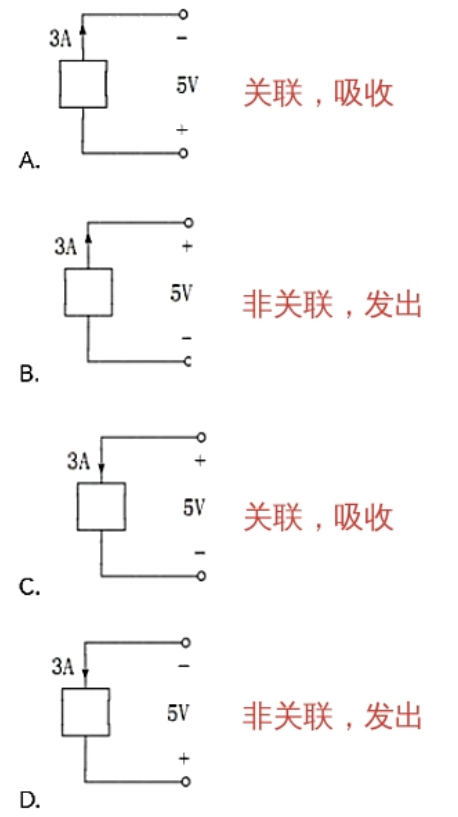

1.  电功率：单位时间内电场力所作的功。（功率P的单位$W$瓦特），能量W的单位$J$（焦耳））
2.  公式
	$P=ui$
	u,i取关联参考方向：p\>0 发出正功率 (实际吸收)，p\<0 发出负功率(实际发出)
	u,i取非关联参考方向：p\>0 发出正功率 (实际发出)，p\<0 发出负功率(实际吸收)
	
3. 电源：P\<0   ui实际方向相反
	负载：P\>0   ui实际方向相同
