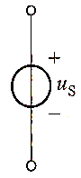
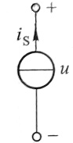

1.  电压源（直流： $U_ {s}$ 交流： $u_ {s}$）
    （1) 定义：其两端电压总保持定值或一定的时间函数，其值与流过其的电流无关的元件\
    （2)  电路符号
	    
    （3)  关系
        1）其两端电压由电源本身决定。与外电路无关
        2）通过电压源的电流由电源及外电路共同决定
    （4)  电压源不能短路 （ i= $\infty$ ）
    （5)  功率
        1）电压、电流参考方向关联
	        物理意义：电场力作功，电源吸收功率（充当负载）
		2）电压、电流参考方向非关联。
			物理意义：克服电场力作功，电源发出功率（起电源作用）
2.  电流源
    （1)  定义：其输出电流总保持定值或一定的时间函数，其值与其两端电压u 无关的元件
    （2)  电路符号
	    
    （3)  关系
        1）电流源的输出电流由电源本身决定，与外电路无关；与它两端电压的方向、大小无关。
        2）电流源两端的电压由电源及外电路共同决定
    （4)  电流源不能断路
    （5)  功率：同电压源
