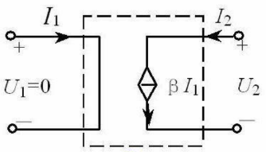
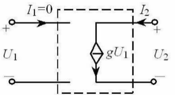
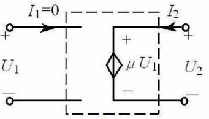
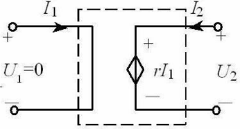

1.  定义：电压或电流的大小和方向不是给定的时间函数，而是受电路中某处的电压(或电流)控制的电源
2.  电路符号
3.  分类
    （1)  电流控制的电流源(CCCS) $\beta$：电流放大倍数
	    
	（2)  电压控制的电流源(VCCS) $g$：转移电导 $g = \frac{i_ {2}}{u_ {1}}$
		
	（3)  电压控制的电压源(VCVS) $\mu$：电压放大倍数
		 
	（4)  电流控制的电压源(CCVS) $\gamma$：转移电阻 $\gamma = \frac{u_ {2}}{i_ {1}}$
		 
4.  比较
    （1)  独立源电压(或电流)由电源本身决定，与电路中其他电压电流无关，而受控源电压(或电流)由控制量决定。
    （2)  独立源在电路中起"激励"作用，在电路中产生电压、电流，而受控源是反映电路中某处的电压或电流对另一处的电压或电流的控制关系，在电路中不能作为"激励"。
