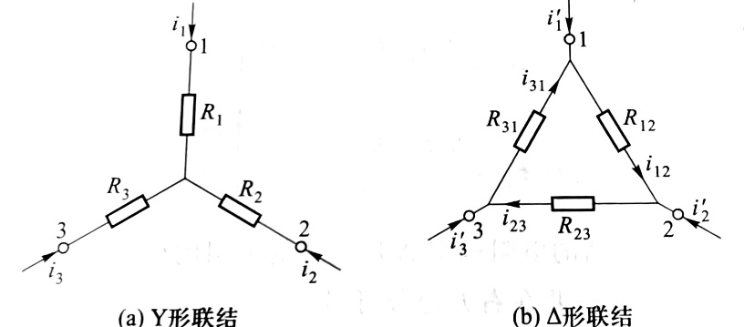

 
1.  Y形和△形联结
    （1)  Y形：连接于一个中心点
		用电流表示电压
	（2)  △形：三个点首尾相连
		用电压表示电流
2.  Y →△ 公式：△形电阻=Y形电阻两两乘积之和 / Y形不相邻电阻
3.  △→Y （多一个点，三角形中间取一个）公式：Y形电阻=△形相邻电阻乘积 / △形不相邻电阻
4.  注意
    （1） 理想电流源串一个元件，将其短路（不求电流源两端电压时）
	    和电压源并的可以去掉
	（2）若三电阻相等：外大内小（ $R_ {\Delta} = 3R_ {Y}$）
	（3）等效对外部有效，对内不成立
	（4）等效电路与外部电路无关

