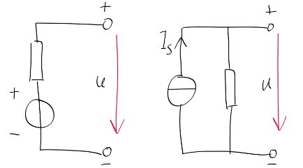

1.  实际电压源，不允许短路（因其内阻小，短路则电流大，可烧毁电源）
    伏安特性： $u = u_ {s} - R_ {s}{i}$
2.  实际电流源，不允许开路（因其内阻大，开路则电压高，可烧毁电源）
    伏安特性： ${i} = i_ {s} - \frac{u}{R_ {s}}$
3. 等效变换 （注意方向！！！）
	
    （1)  电流源→电压源 $u_ {s} = \frac{i_ {s}}{G_ {s}}$ $R_ {s} = \frac{1}{G_ {s}}$
    （2)  电压源→电流源 ${i}_ {s} = \frac{u_ {s}}{R_ {s}}$ $G_ {s} = \frac{1}{R_ {s}}$
    （3)  注意
        1）理想电压源与理想电流源不能转换
        2）等效前后电阻阻值不变

