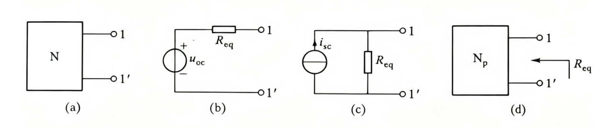

1.  无源(pessive)二端网络：电阻
	有源(active)二端网络：电压源(戴维南定理)、电流源(诺顿定理)
	
2.  戴维南/宁定理：一含独立电源、线性电阻和受控源的端口对外电路来说，可用电压源串电阻等效替换。 
    （1)  步骤：求$R_ {eq}、U_ {oc}$(开路电压)，等效成电压源串电阻，再串待求元件（直接断了待求支路，而不是只待求元件）
    （2)  求 $U_ {oc}$：回路KVL（和开路的地方连着就没电流，但有电压源的话还是有电压的）
    （3)求 $R_ {eq}$
        1) 外加电源法(有受控源就用这个)，独立源置0，受控源不动
        2) $i_ {sc}、U_ {oc}$(短路电流、开路电压法) ：短路电流求的就是短路支路上电流，再用第一次求的开路电压除得电阻            针对有源网络，不然哪来 $I$
        3) 等电位法
        4) 从端口看进去：独立源置0，看不懂就用等电位法求
        5) 有受控源：外加电源，短路电流
    （4）注意：把待求电路还回去
3.  诺顿定理：...，可用电流源并电阻等效替换。 $R_ {eq}、i_ {sc}$(短路电流short)
4.  注意
    （1)  $R_ {eq}$=0， $U_ {oc}$为有限值，则 $i_ {sc}$= $\infty$，不存在诺顿等效电路，只能用戴维南
    （2)  $R_ {eq}$= $\infty$， $i_ {sc}为有限值，则U_ {oc}$= $\infty$，不存在戴维南等效电路，只能诺顿