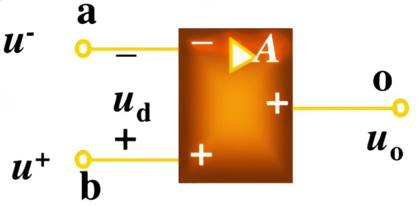

1. 电路模型
	 
	a：倒向输入端，输入电压 $U^{-}$(也能为正)
	b：非倒向输入端，输入电压 $U^{+}$
	o：输出端，输出电压 $U_ {0}$
	A：开环电压放大倍数
2. 有运算放大器的电路分析
	（1）$U_ {+} = U_ {-}$计算没有反馈的那边
	（2）如果$U_ {+}$/$U_ {-}$直接或只有一个电阻连接（没有多余的线！）的地或源，那直接等于0或该源值
   

