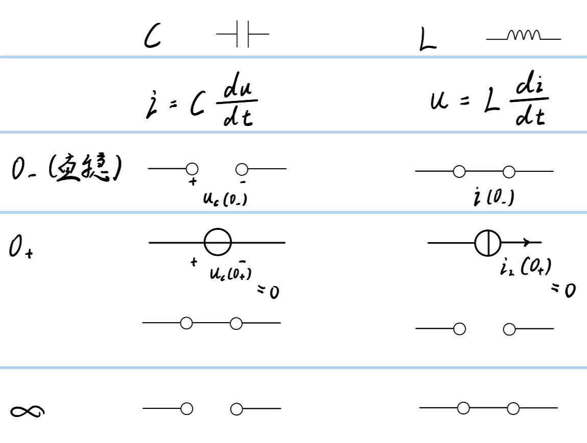

1.  $u_ {c} = U_ {s} + \left( U_ {0} - U_ {s} \right){e}^{- \frac{t}{\tau}}$= $U_ {0}{e}^{- \frac{t}{\tau}}$+ $U_ {s}\left( 1 - {e}^{- \frac{t}{\tau}} \right)$
2.  $f(t) = f(\infty) + \left\lbrack f\left( O_ {+} \right) - f(\infty) \right\rbrack{e}^{- \frac{t}{\tau}}$
3.  三要素法
    （1)  $0_ {-}$：C、L短/断（不是指源，虽然没有CL符号了，但il还是要标）
    （2)  $0_ {+}$：C、L等效成电流/压源
        1）状态量（ $u_ {C}、i_ {L}$）：画 $0_ {-}$图就够了（因为换路定则可以直接有 $0_ {+}$） $t \geq 0$
        2）非状态量：画 $0_ {-}$和 $0_ {+}$图                                                    $t > 0$（否则为0时跃变）
    （3)  $f(\infty)$                $\infty$：C、L短/断
    （4)  $\tau$                      $\tau = RC = \frac{L}{R}$         求 $R_ {eq}$：将电压/流源置0，C、L用电压/流源代替
4. 