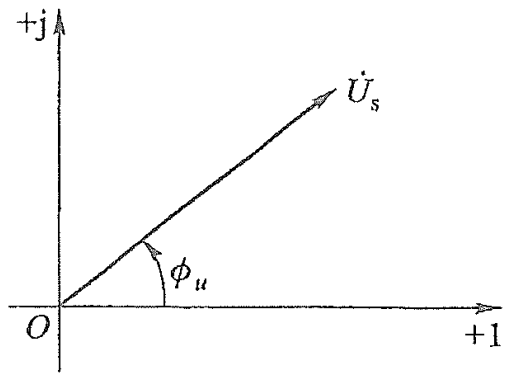

1.  正弦量的向量表示： $\dot{I} = I\angle\varphi$（ ${i}(t) = \sqrt{2}I\cos(\omega t + \varphi)$）
	 相量的模表示正弦量的有效值
	 相量的幅角表示正弦量的初相位
2.  相量图：复平面上用矢量表示相量的图
	
3.  运算
    （1)  加减(同频)： $\dot{U} = {\dot{U}}_ {1} + {\dot{U}}_ {2}$
    （2)  微积分： $\frac{{d}{i}}{{d}t} \rightarrow j\omega\dot{I}$= $\omega I\angle\varphi_ {i} + \frac{\pi}{2}$  、$\int{i}{d}t \rightarrow \frac{\dot{I}}{j\omega}$= $\omega I\angle\varphi_ {i} - \frac{\pi}{2}$
