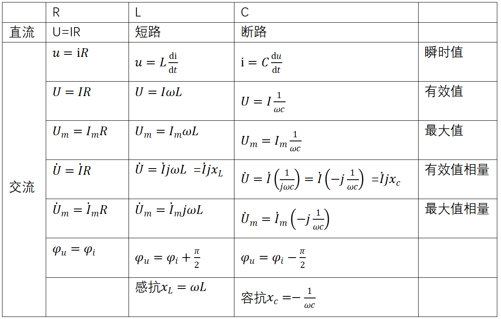
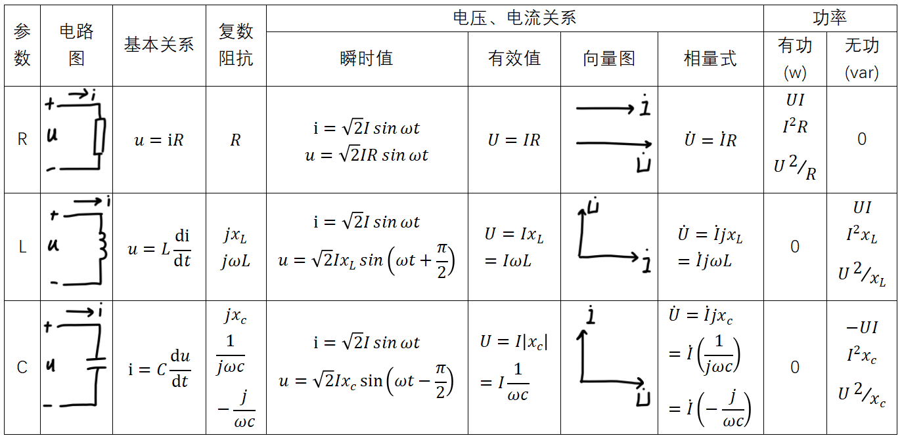

>电感的电压超前电流90度，是在关联参考方向前提下成立，不是永久成立！
1.  基尔霍夫定律的相量形式： $\Sigma{i} = 0\ \ \ \ \Sigma\dot{U} = 0$
2.  R相量形式例子(详见下表)
	时域形式： ${i}(t) = \sqrt{2}I\cos(\omega t + \varphi)$ 、 $U_ {R}(t) = \sqrt{2}RI\cos\left( \omega t + \varphi_ {i} \right)$
	相量形式： $\dot{I} = I\angle\varphi$  、 ${\dot{U}}_ {R} = RI{\angle\varphi}_ {i}$
	相量关系： ${\dot{U}}_ {R} = R\dot{I}$
3.  $U = I|Z|$ ($Z = R + jx_ {C / L}$)
	$\dot{U} = \dot{I}Z$
	
	注意：j体现相位差，+j超前、-j落后（${i} = \frac{u}{x_ {L}}$、 $u = {i}x_ {c}$错误，其没体现相位差）
	
