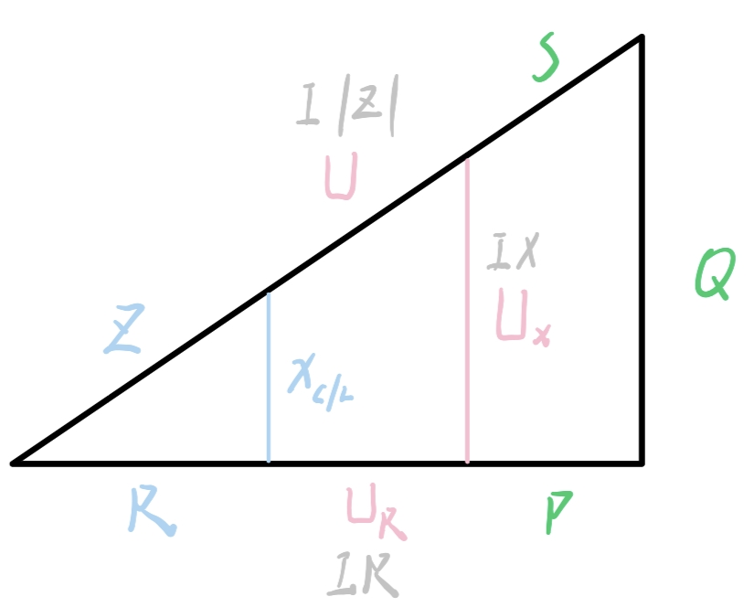

1. 蓝色、粉色、绿色分别为阻抗三角形、电压三角形、功率三角形
	
2.  $\varphi$
	（1) 相位差 $\varphi = \varphi_ {u} - \varphi_ {i}$
	（2) 阻抗角 $z = |z|\angle\varphi$ ，三角形的角（ $\varphi = \arctan\frac{U_ {L} - U_ {C}}{U_ {R}}$， $\varphi = arc\tan\frac{x_ {L} + x_ {C}}{R}$， $\varphi = arc\sin\frac{U_ {L} - U_ {C}}{R}$）
	（3) 功率因数角
3.  阻抗
    （1) $Z = R + jX$ ：$X$\>0电路呈感性，$X$\<0呈容性（电容性质）、 Z体现了相位差， $|Z|$没体现
    （2) $Z = Z_ {1} + Z_ {2} , |Z| = \left| Z_ {1} + Z_ {2} \right|$（ $|Z| = \left| Z_ {1} \right| + \left| Z_ {2} \right|$只有方向相同才能用）
	（3) 阻抗模： $|Z| = \sqrt{R^{2} + X^{2}}$
	（4) 阻抗串： $Z = \sum_ {K = 1}^{n}R_ {k} + jX_ {k}$
4.  导纳
    （1) 导纳并联： $\frac{\dot{U}}{\dot{I}} = \frac{1}{Z_ {eq}}$
    （2) 导纳并=电阻串，Y并=Z串
    （3) 导纳串=电阻并
