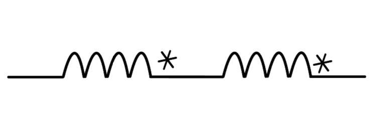
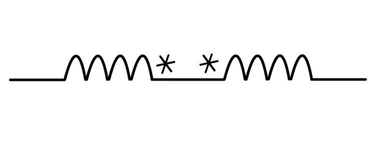
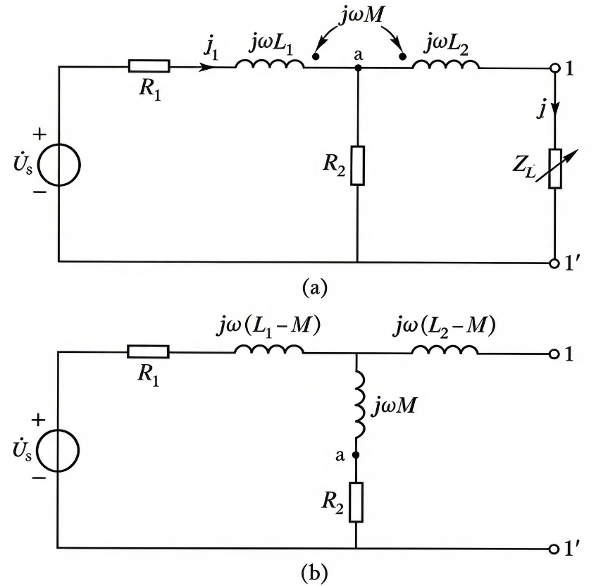

1.  电感
	（1）磁耦合：载流线圈间彼此磁场相互联系的物理现象
	（2）自感 $L_ {1} = \frac{\psi_ {11}}{i_ {1}}$，互感 $M_ {12} = \frac{\psi_ {12}}{i_ {2}}$（下标：结果原因，如2号对1号线圈的作用）
	（3）同向耦合：互感与自感方向一致 自感方向的磁场得到加强
		同名端：同向耦合下的一对电流的入端或出端，用同一符号标出（必须两两确定）
	（4）耦合因数 $k ≝ \frac{M}{\sqrt{L_ {1}L_ {2}}} \leq 1$
		全耦合k≈1，无耦合k≈0
	（5）自感电压 $u_ {11} = L_ {1}\frac{{d}i_ {1}}{{d}t}$，互感电压 $u_ {12} = M\frac{{d}i_ {2}}{{d}t}$
2. 含耦合电感电路的计算
	（1） 顺向串联： $_ {}L_ {eq} = L_ {1} + L_ {2} + 2M$ $_ {}$
			
		反向串联： $L_ {eq} = L_ {1} + L_ {2} - 2M$
			
	（2）去耦等效：把互感转换为自感
	

