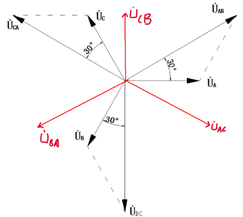
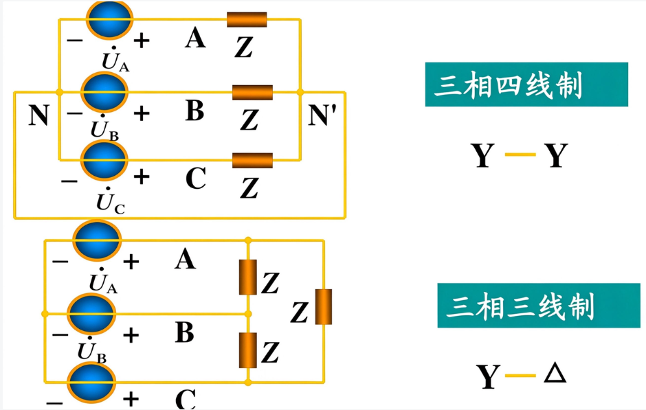

1.  $u_ {A} = \sqrt{2}U\cos{(\omega t){,\dot{U}}_ {A}} = U\angle 0^{0}$
	$u_ {B} = \sqrt{2}U\cos{(\omega t - 120{^\circ}),{\dot{U}}_ {B}} = U\angle - 120{^\circ}$
	$u_ {c} = \sqrt{2}U\cos{(\omega t + 120{^\circ}),{\dot{U}}_ {c}} = U\angle 120{^\circ}$
2.  正序/顺序：ABC
	负序/逆序：CBA
3. 三相四线制，三相三线制
	
